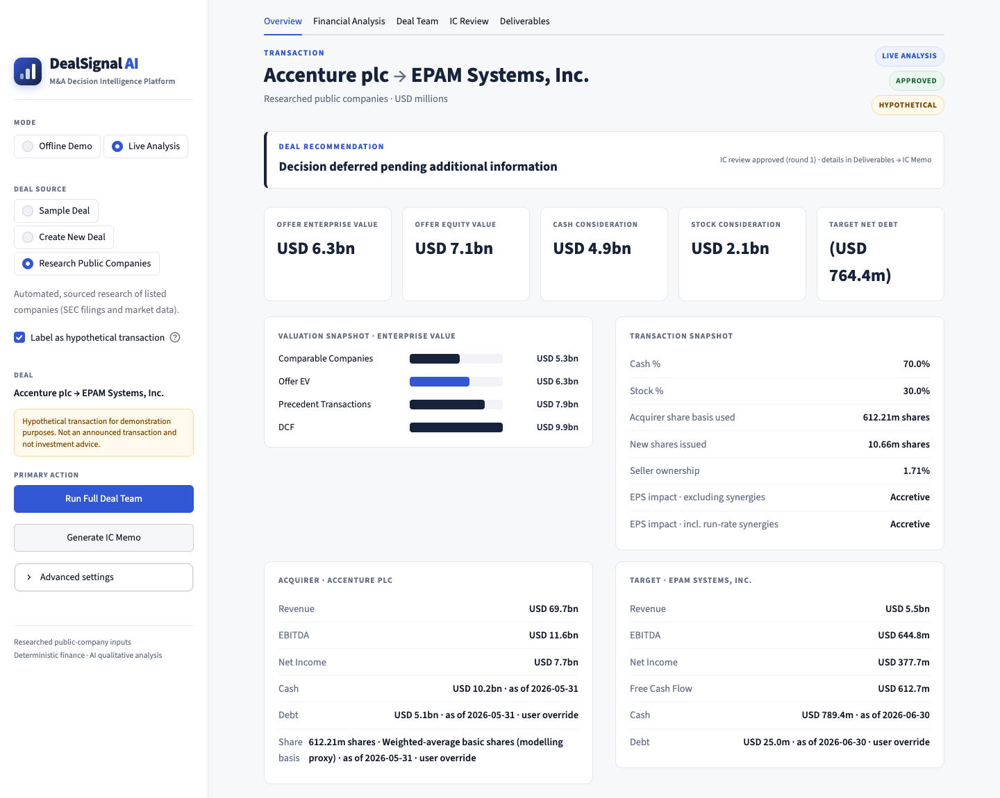
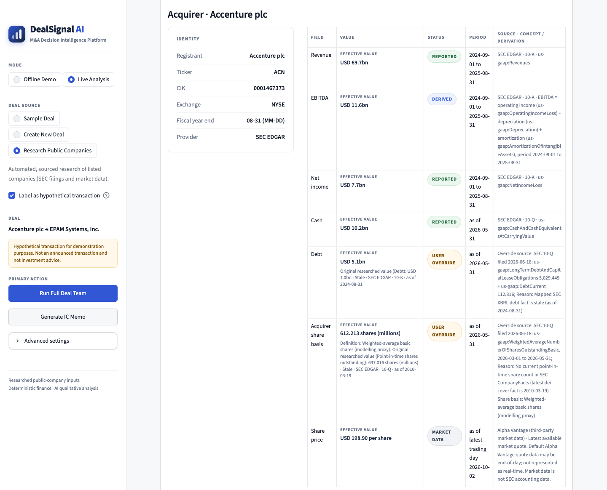
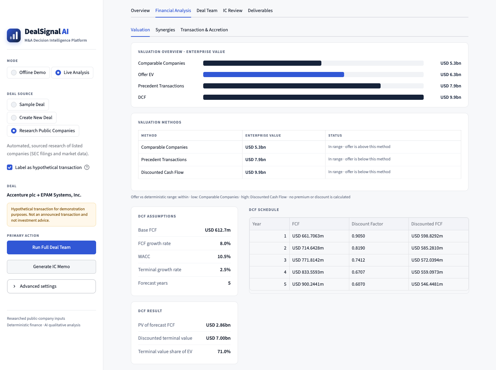
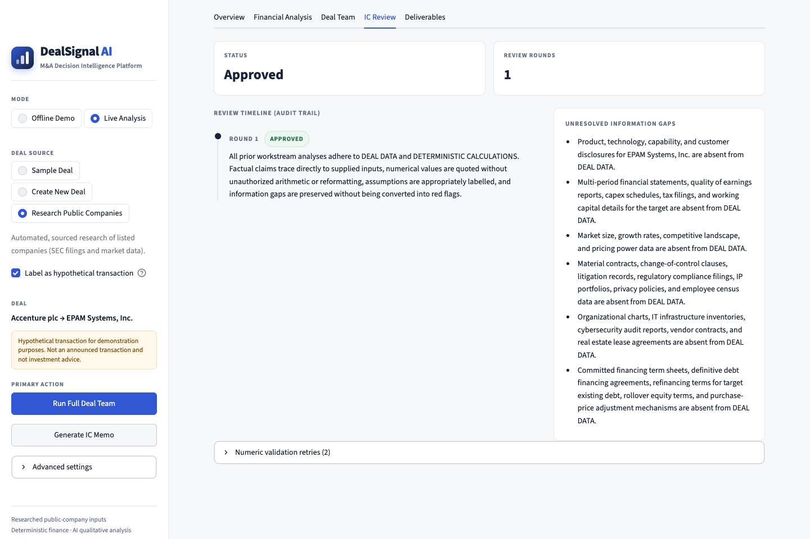
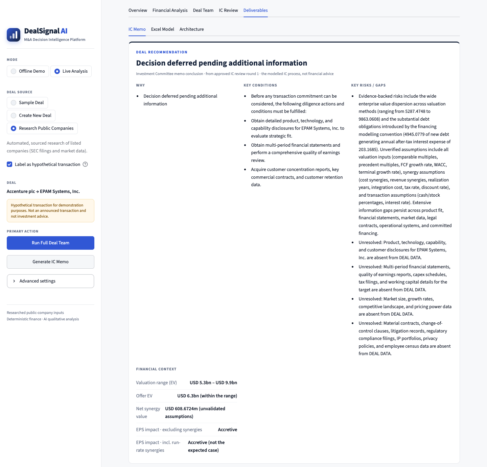
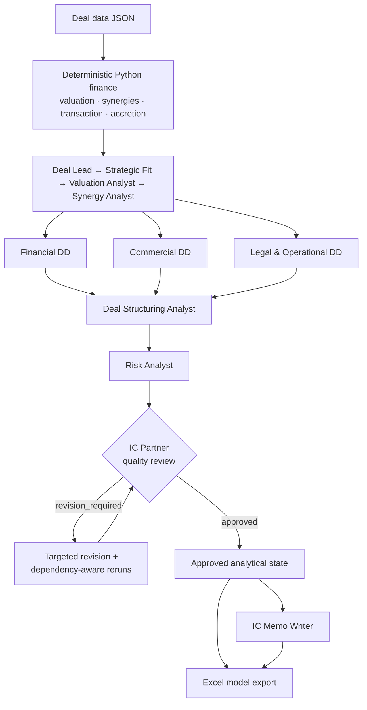

# DealSignal AI

**M&A Decision Intelligence Platform**

*Sourced research · Deterministic finance · AI deal-team analysis*

DealSignal AI combines:

- **sourced public-company research**: SEC EDGAR accounting facts with provenance,
  plus third-party market prices;
- **deterministic M&A finance**: valuation, synergies, transaction mechanics, and
  accretion/dilution in tested Python;
- an **AI M&A Deal Team**: the multi-agent analytical workflow of specialist agents and
  a due-diligence sub-crew;
- **IC quality control**: an IC Partner review with targeted, dependency-aware revisions;
- a **deal recommendation**, drawn from the memo's controlled conclusion;
- an **Investment Committee memo**;
- a **formula-driven Excel model**.

A Streamlit app includes an offline demo that needs no API key. Internally, the analysis
is performed by the AI M&A Deal Team workflow; DealSignal AI is the product around it.

> ⚠️ **Fictional data. Not investment advice.** The sample deal, Northstar Software
> acquiring Atlas Analytics, is invented. Both companies and every figure and assumption
> are illustrative, and any memo conclusion is the output of a modelled IC process,
> not financial advice.

## Live Case Demo

### Hypothetical Accenture → EPAM Systems transaction



This live case demonstrates the complete DealSignal AI workflow:

**SEC EDGAR research → validated inputs → deterministic valuation → transaction mechanics → AI deal team → IC review → deal recommendation**

The example uses a hypothetical acquisition of EPAM Systems, Inc. by Accenture plc to demonstrate the platform on real public-company financial data.

> **Hypothetical transaction for demonstration purposes. Not an announced transaction and not investment advice.**

### Public-company research and provenance



DealSignal AI separates reported, derived, market-data and user-approved values while preserving the original research source and reporting period.

### Deterministic financial analysis



Valuation, DCF, transaction mechanics, synergy calculations and accretion/dilution are calculated deterministically in Python rather than by the LLM.

### Investment Committee quality control



The IC Partner reviews the analytical workstreams, preserves unresolved information gaps and can trigger targeted revisions rather than accepting AI output automatically.

### Deal recommendation



The final recommendation is produced only after the analytical workflow reaches an approved IC state and the Investment Committee memo passes validation.
## Why I Built This

LLMs are useful for judgment: interpreting results, spotting gaps, framing diligence
questions, and writing clearly. They are unreliable at financial arithmetic and at
tracking **where a number came from**. In deal work, one invented multiple or a
decimal silently turned into the wrong percentage is unacceptable.

This project separates the two jobs. Python performs every calculation. The agents
interpret those results, and a validator mechanically rejects any number they write
that no approved source contains.

## What It Does

1. Loads a deal from JSON: acquirer and target financials, market multiples, and DCF,
   synergy, and transaction assumptions.
2. Computes valuation, synergy value, transaction mechanics, and accretion/dilution in
   deterministic Python.
3. Runs nine analytical agents over those results, including a three-agent
   due-diligence sub-crew.
4. The IC Partner reviews all nine analyses and returns a strict JSON review.
5. The orchestrator applies targeted revisions, reruns only the agents whose inputs
   changed, and stops after a bounded number of review rounds.
6. From an approved state, the IC Memo Writer drafts the memo with one of four
   controlled conclusions.
7. The Excel exporter writes a nine-sheet model whose formulas are checked against the
   Python engine before the file is saved.

## Architecture



The three due-diligence agents are peers: none of them sees another's output.

## Python vs LLM Responsibilities

| Python (deterministic, tested) | LLM agents |
|---|---|
| Valuation arithmetic: comps, precedents, DCF | Interpretation and synthesis |
| Synergy valuation | Qualitative judgment |
| Transaction mechanics and accretion/dilution | Diligence questions and information gaps |
| Agent dependency graph, revision routing, review limits | Quality-control review (IC Partner) |
| Numeric provenance validation and strict JSON parsing | Memo drafting (IC Memo Writer) |
| Excel formulas and formula-vs-Python validation | |

## Deal Team

| Step | Agent | Role |
|---|---|---|
| 1 | Deal Lead | Preliminary acquisition thesis and key unknowns |
| 2 | Strategic Fit Analyst | Scale, product, geographic, and customer fit, only where data exists |
| 3 | Valuation Analyst | Interprets the deterministic valuation results |
| 4 | Synergy Analyst | Critiques supplied synergy assumptions and the deterministic synergy value |
| 5A | Financial Due Diligence | Separates financial evidence from information gaps |
| 5B | Commercial Due Diligence | Market, customer, and revenue-model diligence |
| 5C | Legal & Operational Due Diligence | Contracts, IP, regulatory, systems, and integration |
| 6 | Deal Structuring Analyst | Consideration structure and deterministic transaction mechanics |
| 7 | Risk Analyst | Consolidates risks, assumptions, and gaps with attribution |
| — | IC Partner | Quality-control reviewer; requests revisions via strict JSON |
| — | IC Memo Writer | Drafts the Investment Committee memo from the approved state |

The nine analytical agents may not make proceed/pass recommendations. Only the memo
states a conclusion, drawn from a fixed four-option vocabulary.

## Deterministic Financial Engine

`valuation.py` is pure Python and unit-tested against hand-checked values:

- **Comparable companies**: EV = EBITDA × peer EV/EBITDA
- **Precedent transactions**: EV = EBITDA × transaction EV/EBITDA
- **Loss-making targets**:
  - When target EBITDA is zero or negative, EV/EBITDA methods are recorded as **not
    applicable** (with the reason). They never produce a negative EV and are never
    replaced by zero.
  - Comparable and precedent valuation then use **EV/Revenue** multiples
    (EV = revenue × multiple), alongside the DCF.
  - The valuation range uses only applicable methods; with fewer than two, no range is
    formed.
- **DCF**: constant-growth forecast with a Gordon-growth terminal value; rejects WACC ≤ terminal growth
- **Synergy valuation**: after-tax run-rate synergies discounted over a finite period, less integration cost
- **Transaction mechanics**: EV-to-equity bridge, cash/stock consideration, new debt under the model's financing convention, share issuance, pro forma ownership
- **Accretion/dilution**: single-year EPS view, excluding and including run-rate synergies

Enterprise value and equity value are kept under separate keys throughout.
`deal_analysis.py` only calls these functions and arranges their outputs; a test fails
if an arithmetic operator appears in it.

## Reliability / Guardrails

These controls are **designed to reduce unsupported outputs**. They cannot guarantee
that an LLM never writes something wrong.

- **Numeric provenance validator.** Every numeral an agent writes must exactly match a
  value in DEAL DATA or DETERMINISTIC CALCULATIONS. Percentage conversions, rescaling,
  rounding, and sign flips are rejected. For strict-JSON agents, decoded strings are
  checked too, so JSON escapes cannot hide numbers.
- **Source layers.** Prompts separate DEAL DATA, DETERMINISTIC CALCULATIONS, PRIOR
  ANALYSES, PREVIOUS OUTPUT, REVIEW FEEDBACK, and IC REVIEW CONTEXT. Only the first two
  can authorize a fact or a number.
- **Evidence discipline.** Missing information is labelled an information gap, never
  turned into a risk. Agents may not infer products or markets from a company's name,
  and must attribute other agents' hypotheses.
- **Strict parsing.** IC reviews and memos must match exact JSON schemas. Malformed
  output is rejected, never repaired.
- **Bounded review.** Review rounds are capped. An unresolved review ends as
  `review_limit_reached` and blocks memo generation and export.
- **Dependency-aware reruns.** Revising an agent reruns only its downstream dependents,
  each once, in topological order.
- **Partial-state recovery.** Failures raise `OrchestrationError` carrying everything
  completed so far.
- **LLM resilience.** One SDK attempt per request, a request timeout, bounded
  retry/backoff, and model fallback on capacity or daily-quota errors.
- **Excel validation.** Every workbook formula is evaluated and compared with the
  Python engine before the file is saved.

## Sample Deal

`data/sample_deal.json` describes **Northstar Software acquiring Atlas Analytics**, in
USD millions. Both companies are **fictional**. The file deliberately contains only
financials and assumptions (no product, customer, market, or legal data), so a correct
analysis reports most diligence areas as information gaps.

## Streamlit App

The app has five sections: **Overview**, **Financial Analysis** (Valuation, Synergies,
Transaction & Accretion), **Deal Team**, **IC Review**, and **Deliverables** (IC Memo,
Excel Model, Architecture).

- **Offline Demo** (default) needs no API key or network.
  - The **deterministic finance is real**: the same Python engine and figures as live mode.
  - The **qualitative agent text, IC reviews, and memo are illustrative** demo content,
    clearly labelled in the app. They still run through the real orchestrator,
    validator, and parsers, including a genuine revision cascade.
- **Deal source**: analyze the fictional **Sample Deal**, **Research Public Companies**
  (see below), or choose **Create New Deal** to
  enter your own inputs (company names, financials, multiples, DCF, synergy, and
  transaction assumptions). Rates are entered as percentages and stored as exact
  decimals. Inputs are validated (e.g. Cash % + Stock % = 100%, WACC above terminal
  growth), then built into the same `Deal` type and checked by the same finance engine.
  A deterministic preview (EVs, valuation range, net synergy value, consideration)
  appears **before any LLM call**, and works without an API key. Changing the deal
  clears any previous analysis. To retrieve a listed company's figures automatically,
  use **Research Public Companies** instead.
- **Deal recommendation**: after the deal team has run, the IC review has approved, and
  the memo is generated, a **Deal Recommendation** card appears on Overview and above the
  memo. It shows the memo's own controlled conclusion (one of four) with its stated
  reasons, conditions, and risks, plus deterministic financial context. There is no score
  or probability, and nothing is shown before that point.
- **Live Analysis** runs the real deal team with Gemini, only when you click an action.
  It shows the configured models (never the key), keeps partial results if a run
  stops early, and enables memo generation and export only after an approved review.

## Research Public Companies

A third deal source fills the company financials from **official filings** instead of
manual entry. Coverage today: **United States — SEC-reporting public companies**.
**France and Germany are planned but not supported yet**. They appear in the app as
"coming later" and nothing is silently routed through the SEC.

```
CompanyResearchProvider (generic interface)
 ├─ SECProvider          United States — implemented (SEC EDGAR)
 ├─ France provider      planned
 └─ Germany provider     planned
MarketPriceProvider (separate from accounting facts)
 └─ Alpha Vantage        GLOBAL_QUOTE: latest available / end-of-day quote (optional key)
```

- **Official accounting facts.** Identity comes from SEC's ticker/CIK mapping and
  company submissions; financials come from **SEC XBRL CompanyFacts**. No LLM
  researches, selects, or estimates any financial value.
- **Deterministic mapping and periods.** Concept priorities are fixed in code.
  - Income and cash-flow facts use the latest **annual 10-K fiscal year**, excluding
    quarterly and year-to-date facts. Amendments and later filings win for the same
    period.
  - Balance-sheet facts use the latest 10-K/10-Q date.
  - Every value shows its own period: revenue, cash, and the share price can come
    from different dates.
- **Reported vs derived vs missing.**
  - EBITDA is used as REPORTED only under an exact EBITDA concept. Otherwise it is
    DERIVED as operating income + combined D&A, or else operating income + separate
    depreciation + amortization of intangibles, always for the same annual period and
    labelled as not company-reported.
  - Free cash flow is DERIVED as operating cash flow − capex.
  - Debt follows a fixed hierarchy of non-overlapping concepts, so nothing is double
    counted:
    1. a total-debt fact, or compatible current + non-current components;
    2. otherwise recognised debt instruments (convertible notes, senior notes, notes and
       loans payable) at **carrying amount**, never fair value or principal;
    3. as a last resort, a single issuer-specific extension fact that passes strict,
       tested predicates (noted in Source Details).

    Possibly overlapping instruments or several qualifying extension facts are
    **MISSING**. SEC's CompanyFacts dataset mainly contains standard-taxonomy facts, so
    the extension fallback rarely applies in practice.
  - Anything that can't be found reliably is **MISSING**. It is never guessed and never
    set to zero.
- **Provenance before approval.** Every value shows its status badge, period, source,
  and concept or derivation. A "Source details" panel adds the filing form, filed date,
  accession number, filing URL, raw vs normalized value, and derivation ingredients.
- **Mandatory review.** You accept, override, or fill in each value before a deal is
  built. An override keeps the original researched value (and an optional reason) in
  the audit trail.
- **Accounting facts come from SEC EDGAR; the market price comes from Alpha Vantage.**
  - The price is a separate, third-party input (Alpha Vantage `GLOBAL_QUOTE`), shown
    with a **Market data** badge and its latest trading day.
  - It is treated as the **latest available / end-of-day price** and is never described
    as real-time.
  - It needs an optional free `ALPHA_VANTAGE_API_KEY`. Without a key, or if the lookup
    fails (rate limit, unknown ticker, network), the share price is simply **MISSING**
    and financial research continues.
  - You can always enter or override the share price; an override keeps the original
    Alpha Vantage value in the audit trail.
- **Deal assumptions stay manual.** Multiples, DCF, synergy, and transaction inputs are
  entered by you and labelled **User assumptions**, not researched evidence.
- **Same pipeline.** The approved inputs build the existing `Deal` type through the
  same builder and validation as a custom deal. The deterministic preview, deal team,
  IC review, memo, and Excel export are unchanged. Excel input comments cite the
  research source (or the user override) for each field.
- **Fair access.** A declared `SEC_USER_AGENT`, request timeouts, bounded retries, a
  request-rate limit, and a local response cache (`.research_cache/`, gitignored). A
  two-company lookup makes about five requests.
- Only **financial inputs** are researched. Strategy, customers, markets, legal, and
  news are **not**; they remain information gaps for the agents.

## Excel Output

`excel_export.py` writes a formula-driven model with nine sheets: **IC Summary,
Assumptions, Valuation, Synergies, Transaction Structure, Accretion Dilution, Due
Diligence, Risk Summary, IC Memo**.

It follows banking conventions:
- **Font colours:** blue for inputs, black for formulas, green for cross-sheet links.
- **Fills:** yellow for unverified assumptions.
- **Number formats:** negatives in red parentheses, and zeros shown as "-".
- **Traceability:** every input cell has a source comment, and the Valuation sheet has
  one comparison chart.

## Installation

Requires a stable Python 3.10+ release (developed on 3.12).

```bash
python -m venv .venv
source .venv/bin/activate        # Windows: .venv\Scripts\activate
pip install -r requirements.txt
```

## Configuration

Live Analysis needs a Gemini key; Research Public Companies needs an SEC User-Agent.
Copy the template to `.env` (gitignored) and replace the placeholders:

```bash
cp .env.example .env
```

```
GEMINI_API_KEY=your_api_key_here
GEMINI_MODEL=gemini-3.5-flash-lite
GEMINI_FALLBACK_MODELS=gemini-3.7-flash,gemini-3.6-flash
# Research Public Companies (SEC EDGAR): a descriptive User-Agent with contact details.
SEC_USER_AGENT=AI-MA-Deal-Team your-email@example.com
# Optional market price for Research Public Companies (third-party; free key available).
ALPHA_VANTAGE_API_KEY=
```

`GEMINI_FALLBACK_MODELS` is optional. The key is never printed, logged, or shown in the
app. `SEC_USER_AGENT` is needed only for Research Public Companies (SEC requires it; no
API key). Set your own contact details. `ALPHA_VANTAGE_API_KEY` is optional: without it,
share prices are entered manually.

## Running the Offline Demo

```bash
streamlit run app.py                 # "Offline Demo" is the default mode
python export_sample_workbook.py     # writes reports/Northstar_Atlas_MA_Model.xlsx
```

The sample workbook's qualitative sheets contain illustrative demo content. Don't
present them as live deal-team output. Generated workbooks are gitignored.

## Running Live Analysis

1. Complete **Configuration** above.
2. Run `streamlit run app.py`, switch to **Live Analysis**, and click
   **Run Full Deal Team**. A clean approval takes about ten LLM calls; revisions add
   more.
3. After an approved review, click **Generate IC Memo**, then build and download the
   workbook in the **Excel Model** tab.

Command-line alternative: `python run_agents.py`, the CLI wrapper around
`DealTeamOrchestrator`. It runs the nine agents and the IC review loop and prints each
stage.

## Running Tests

```bash
pytest -q
```

The suite has **1,133 tests** (one hygiene check runs only when a local Alpha Vantage key is configured). None needs network access or an API key: they use
scripted fake LLMs and Streamlit's `AppTest` harness. They cover:
- the finance engine;
- the numeric validator;
- the IC review and memo parsers;
- the dependency cascade and audit trail;
- partial-state recovery;
- real `.xlsx` round-trips with formula recalculation;
- the offline app;
- SEC selection, mapping, derivation, and provenance rules with small fixtures (no network);
- secret hygiene.

## Project Structure

```
├── app.py                    # Streamlit UI (presentation only)
├── ui_helpers.py             # testable UI data, formatting, actions, errors
├── ui_components.py          # CSS and HTML-escaped visual components
├── .streamlit/config.toml    # light theme (no secrets)
├── demo_state.py             # offline demo: scripted client + labelled demo content
├── deal_input.py             # custom deal form -> validated models.Deal
├── research/                 # company research (provider-neutral core)
│   ├── providers/sec/        # SEC EDGAR provider: client, mappings, period selection
│   └── market_data/          # market-price abstraction + Alpha Vantage provider
├── research_ui.py            # Research Public Companies flow (Streamlit)
├── ui_forms.py               # shared deal-field input widget
├── valuation.py              # deterministic finance engine
├── deal_analysis.py          # wires deal data into valuation.py (no arithmetic)
├── models.py                 # typed deal dataclasses and loader
├── agents/                   # BaseAgent, nine analytical agents, IC Partner, memo writer
│   ├── registry.py           # canonical names, dependency graph, rerun planning
│   └── due_diligence/        # Financial, Commercial, Legal & Operational DD
├── agent_validation.py       # numeric provenance validator
├── orchestrator.py           # nine-agent run, IC review loop, revisions, audit trail
├── ic_review.py              # strict IC review parser
├── memo.py                   # memo eligibility gate, memo parser, MemoResult
├── excel_export.py           # workbook builder + pre-save validation
├── excel_formulas.py         # evaluator for the exported formula subset
├── llm_client.py             # Gemini client: timeout, retry, model fallback
├── config.py                 # settings from environment / .env
├── run_agents.py             # CLI wrapper around DealTeamOrchestrator
├── export_sample_workbook.py # offline demo workbook export
├── data/sample_deal.json     # fictional sample deal
├── reports/                  # generated workbooks (gitignored)
└── tests/
```

## Design Decisions

- **Python calculates; LLMs interpret.** The engine is small, explicit, and tested. The
  agents never introduce a number that the input or the engine did not supply.
- **Enforced, not just prompted.** The rules that matter for numbers and structure have
  deterministic checks behind them: the validator, the parsers, the eligibility gates,
  and the Excel pre-save check.
- **Hand-written orchestration.** There is no agent framework. The dependency graph,
  cascade, and review loop are small, explicit Python that can be read and tested.
- **Auditable state.** Every agent version and review round is kept. The memo and the
  workbook are built only from current, approved outputs.

## Limitations

- The sample deal is fictional, and all inputs (sample or custom) are single-period and
  simplified.
- Automatic research covers **SEC-reporting U.S. companies only**. France and Germany
  are planned; other companies must be entered manually. Qualitative company
  information and diligence documents are not ingested.
- Researched EBITDA is usually a simple derivation (operating income + D&A). Only one
  share-count total is used (share classes are not combined), and lease liabilities are
  excluded from debt.
- Market prices come from a third-party API (Alpha Vantage): latest available /
  end-of-day, not real-time, subject to free-tier rate limits, and sometimes unavailable.
  US listings only for now.
- Companies reporting in different currencies can't be combined (no FX conversion).
- Financing is a **modelling convention**: the cash portion is assumed to be fully
  debt-funded. There is no debt schedule, and no capacity or covenant analysis.
- Synergy assumptions are supplied, not researched, and are modelled at full run-rate
  with no ramp-up.
- Live analysis depends on Gemini availability and quota.
- Agents can still reach weak judgments within the rules. The controls reduce
  unsupported output; they do not certify analysis quality.
- **Not investment advice.**

## Future Improvements

- European research providers (France, Germany, ESEF filings) and the UK, via the
  same `CompanyResearchProvider` interface
- Additional market-data providers
- A richer operating model with a multi-year forecast
- Debt schedule, merger model, and purchase price allocation
- Scenario and sensitivity analysis computed in Python
- Real diligence-document ingestion (data room)
- Multiple LLM providers
